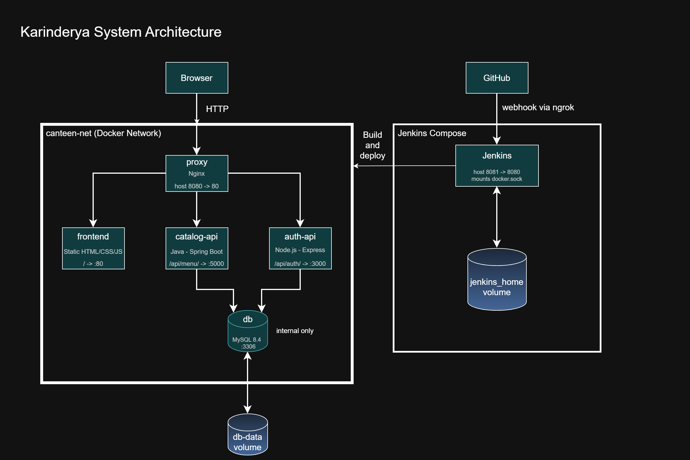

# \# Karinderya: Campus Canteen Ordering System

SYSIN Final Project (System Architecture and Integration)
Group: Basa Group
# 

# \## Description

Karinderya_proto is a campus canteen ordering system where students can easily view the available menu items without needing an account, while canteen staff can securely log in to manage the menu. Staff have the ability to add, edit, or remove dishes, ensuring that the displayed menu is always up to date. The system runs as Docker containers behind a single Nginx entry point, with Jenkins handling automated build, test, and deployment on every push to `main`.

# \## Architecture



```
Browser --> proxy (Nginx :8080)
|-- /            --> frontend   (Nginx, static pages)
|-- /api/menu/   --> catalog-api (Spring Boot)   --+
'-- /api/auth/   --> auth-api    (Express) --+--> db (MySQL)
[ network: karinderya-net | volume: db-data ]

Developer -- git push --> GitHub -- webhook (ngrok) --> Jenkins
Jenkins: Checkout > Test > Build Images (tag = build #) > Deploy > Smoke Test
```

| Container | Technology | Role | Port |
| --- | --- | --- | --- |
| proxy | Nginx 1.27-alpine | Single entry point, routes by path | 80, published as 8080 |
| frontend | Static HTML/CSS/JS on Nginx | Public menu, staff login, staff admin page | 80 |
| catalog-api | Java 21, Spring Boot 3 | Menu item CRUD | 5000 |
| auth-api | Node.js 20, Express | Staff login, JWT, staff accounts | 3000 |
| db | MySQL 8.4 | Users and menu items, volume `db-data` | 3306 (not published) |
| jenkins | Jenkins LTS + Docker CLI | CI/CD server (separate compose) | 8080, published as 8081 |

# \## Prerequisites

- Docker Desktop (Docker Engine with Compose v2)  
- Git  
- ngrok account and client (for GitHub webhook)  
- GitHub account with access to this repository

# \## How to start Jenkins

```bash
cd infra/jenkins
docker compose up -d --build
docker exec jenkins cat /var/jenkins_home/secrets/initialAdminPassword
```
1. Open http://localhost:8081 and paste the password.
2. Install the suggested plugins, then install **Docker Pipeline**.
3. Create the admin user.
4. Add a **Secret file** credential with ID `karinderya_proto-env` (your real `.env`).
5. Create a Pipeline job: *Pipeline script from SCM*, this repository, branch `main`, Script Path `Jenkinsfile`.

# \## How to start the stack

```bash
cp .env.example .env      # then edit the values
docker compose up -d --build
```

Open http://localhost:8080. Stop with `docker compose down` (data stays in the `db-data` volume).

Staff login uses the `ADMIN_USER` and `ADMIN_PASSWORD` values from `.env`.

# \## Trigger setup (webhook / Poll SCM)

- **Primary:** GitHub webhook. Run `ngrok http 8081`, then in GitHub go to *Settings > Webhooks > Add webhook*. Payload URL is `https://<ngrok-url>/github-webhook/`, content type `application/json`, event: push. The Jenkinsfile uses `githubPush()`.
- **Fallback:** Poll SCM with `H/2 * * * *` in the job configuration.

# \## Team and roles

| Member                       | Role                                 |
| Basa, Alwen Nicko J.         | Project Lead / Scrum Master          |
| Delos Reyes, Cris Danniel E. | DevOps / CI-CD Engineer              |
| Bangalan, Abegail Y.         | Infrastructure Engineer              |
| Solomon, Nicole Anne L.      | Backend and Database Engineer        |
| Perez, Jewel Angelique B.    | Frontend, QA, and Documentation Lead |
